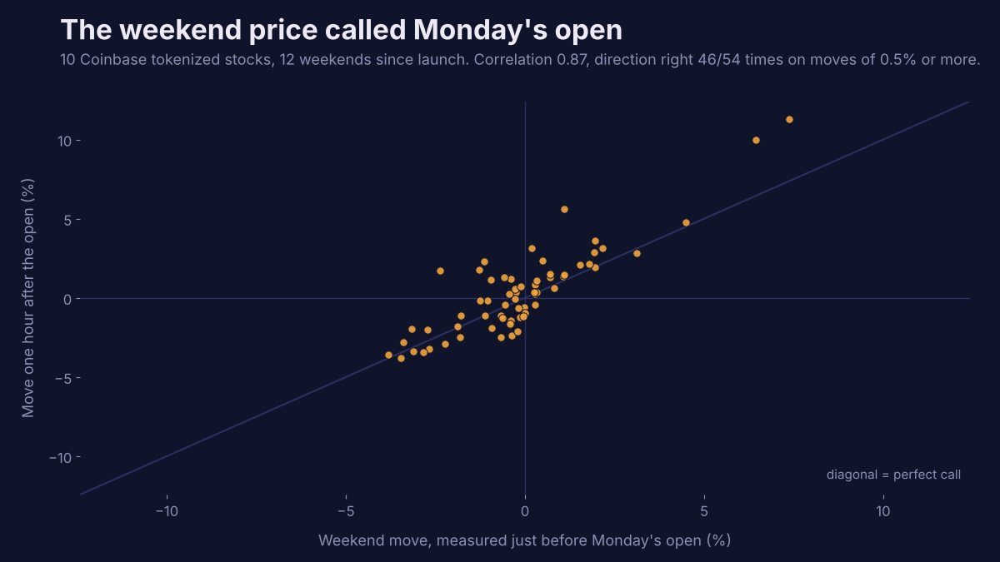

# After Hours

**Stocks close at 4pm. Their tokens on Base don't.**

After Hours shows where each Coinbase tokenized stock is trading on Base right now, compared with the Chainlink price that froze when the US market shut, and lets non-US holders act on that gap with one swap.

Built for Base **Stocks Maxxing** (Programmable Stock Markets track).

## What you see

For each stock, one row:

- **Frozen price (ice tick):** the last Chainlink update before the market shut. These feeds stop moving outside market hours and during corporate actions.
- **Live Base price (amber dot):** the deepest Aerodrome pool, via DexScreener.
- **Hyperliquid perp (ring):** the move of the 24/7 `xyz:` stock perp since the same moment. When Base and Hyperliquid agree, the overnight move is probably real.

The headline is the widest gap right now, written as a sentence.

## Does the weekend price mean anything?

Yes, mostly. Over 12 weekends since launch, the weekend move on Hyperliquid predicted the move to one hour after Monday's open with a correlation of 0.87, cutting the error by 47% compared with assuming no change, and got the direction right 46 times out of 54. Full method and limits: [`research/`](research/).



## Try it in one command (no wallet, no keys)

```bash
git clone https://github.com/Makabeez/after-hours && cd after-hours
npm run judge      # prints the live gap board in your terminal, Node 18+
npm run dev        # local site on http://localhost:3000
```

## How trading works

1. Quote from the KyberSwap aggregator (keyless, browser-side).
2. Approve the **exact** input amount, never unlimited.
3. Swap. Every transaction carries the ERC-8021 builder-code suffix `bc_il5mvrgl`, so onchain activity is attributable to this app.

Trading is turned off for visitors in the United States (Vercel geo header), and every trader must confirm they are not a US person. Coinbase tokenized stocks are only available in eligible jurisdictions outside the US. The board itself is readable by anyone.

## Real vs simulated

| Part | Status |
|---|---|
| Frozen prices | Real: Chainlink feeds on Base mainnet, read live |
| Base prices | Real: Aerodrome pools via DexScreener |
| Hyperliquid move | Real: `xyz:` perp marks and 5-minute candles |
| Swaps | Real: KyberSwap routes on Base mainnet, signed by the user's own wallet |
| Builder-code attribution | Real: ERC-8021 suffix appended to calldata |
| Weekend-gap study | Real historical data (12 weekends). Results, method and limits in [`research/`](research/) |

## Stack

Static page (`public/`) plus two Vercel functions (`api/board.js`, `api/geo.js`). No framework, no database, no API keys. `api/_lib.js` holds every data source and the NYSE calendar.

## Not investment advice

This is a hackathon prototype. Prices can be stale, routes can fail, and a gap is not a guarantee of where a stock will open.
