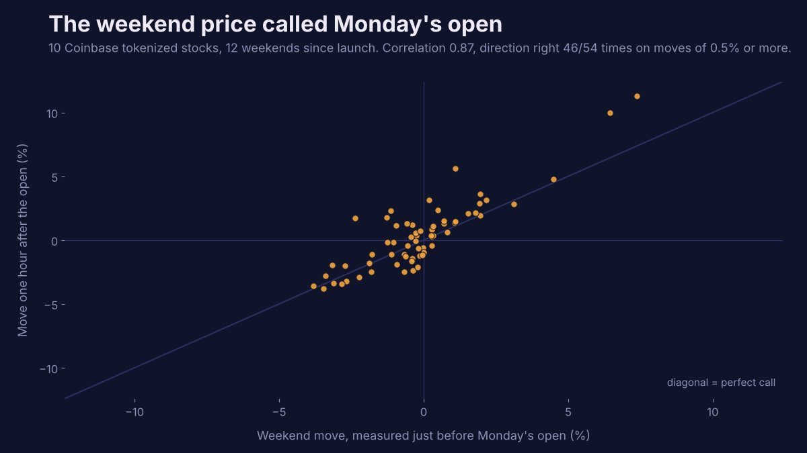

# Weekend-gap study

**Question:** when the US market is shut, does the price of a Coinbase tokenized stock on Base or Hyperliquid tell you where it will open on Monday?

**Answer, so far:** mostly yes. Across 10 stocks and 12 weekends since launch (Aug 31 to Nov 16, 2026):

| Predictor | Observations | Correlation | Error vs. "no change" | Direction right (moves ≥ 0.5%) |
|---|---|---|---|---|
| Hyperliquid `xyz:` perp, weekend move | 64 | 0.87 | 47% lower (1.07 vs 2.03 pts) | 46 / 54 |
| Same, excluding the two largest weekends | 62 | 0.79 | 44% lower (0.99 vs 1.75 pts) | — |
| Aerodrome pool on Base, weekend move | 29 | 0.89 | 49% lower (0.98 vs 1.91 pts) | 21 / 25 |



## Method

For each stock and each weekend:

1. **Reference moment:** the last Chainlink update before Monday's open, at least 12 hours earlier. The feeds keep updating into US extended hours, so this is usually Friday evening, not the 4pm close.
2. **Weekend move:** the venue's price in the hour before Monday's 9:30 ET open, compared with its own price at the reference moment. Using each venue's own reference removes unit and basis differences (for example SNDK on Hyperliquid).
3. **Monday move (truth):** the same venue's price one hour after the open, compared with the same reference.
4. Error is in percentage points. "No change" means predicting a 0% move.

Labor Day (Sep 7) is handled; the reopen moves to Tuesday.

## Limits, stated up front

- **Truth is a venue price, not the NYSE print.** During market hours Hyperliquid's oracle and the Aerodrome pools track the live stock closely, but this is not the official opening auction.
- **Small sample.** 12 weekends, and the Aerodrome column covers only 4 stocks (AAPL, AMZN, GOOGL, META), because the free historical DEX API rate-limits heavily. More will be added.
- **Two weekends drive the top of the chart:** AMZN (Nov 2) and SPCX (Oct 5). Without them the correlation drops from 0.87 to 0.79 and the result still holds.
- **The weekend price under-reacts.** On average the Monday move was about 1.2× the weekend move (beta 1.2), so treat the board's gap as a floor, not a forecast.
- **A first pass using Chainlink as truth was wrong.** Chainlink only publishes on a 0.5% move or a 24-hour heartbeat, and in 64% of Monday opens it did not update within the first hour. That made small real gaps look like zero. Apps that settle or liquidate on that feed at Monday's open should know this.

## Reproduce

```bash
python3 research/fetch.py     # Chainlink rounds (Base RPC), Aerodrome candles (GeckoTerminal), Hyperliquid candles; caches to ./cache
python3 research/analyze.py   # recomputes the table from the cache
```

`weekend_gaps_v2.csv` holds every observation and `summary_v2.json` holds the numbers above.
